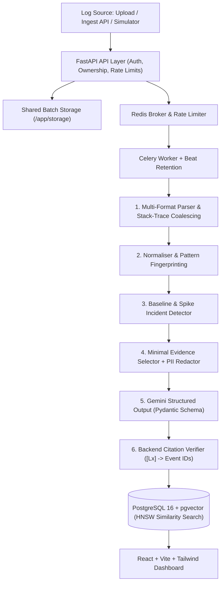

# IncidentLens

**AI-Powered Incident Log Explainer with Evidence-Linked Root-Cause Reports.**

## Problem Statement

When a microservice outage occurs, on-call engineers face tens of thousands of interleaved `INFO`, retry, and cascading timeout lines across multiple services before finding the original failure. Sending raw log tails straight to an LLM is expensive, noisy, leaks secrets/PII, and produces unverified guesses with hallucinated causes.

**IncidentLens** solves this end-to-end: it parses multi-format logs (including multi-line stack traces), normalizes variable tokens into stable error pattern fingerprints, scores rolling-baseline error spikes to cluster incidents and pinpoint the earliest anomaly origin, extracts a minimal redacted evidence window, generates a structured Gemini root-cause hypothesis, and **verifies every `[Lx]` citation against real PostgreSQL event IDs** before presenting the report in an interactive dashboard.

---

## Architecture



See [docs/architecture.md](docs/architecture.md) for component internals and [docs/decisions.md](docs/decisions.md) for Architectural Decision Records (ADRs 001–017).

---

## Key Features

- **Multi-Format Parsing & Stack-Trace Coalescing**: Ingests JSON/NDJSON, CSV, and structured or free-form plain-text logs via file upload or `X-API-Key` HTTP streaming (`POST /api/v1/ingest`).
- **Deterministic Log Normalization & Pattern Grouping**: Masks UUIDs, timestamps, IP addresses, numbers, and hex tokens to collapse repetitive noise into fingerprinted `ErrorPattern` templates with time-series buckets.
- **Rolling Baseline Spike & Origin Detection**: Clusters anomalous error windows into scoped `Incident` timelines, correlates deployment markers, and ranks origin error patterns cleanly with 0 false alarms on healthy controls.
- **Minimal Evidence Budgeting & Redaction**: Compresses raw incident logs by **98.42%** before LLM transmission while scrubbing API keys, bearer tokens, passwords, emails, and PII in `backend/app/pipeline/redaction/redactor.py`.
- **Citation-Verified AI Reports**: Enforces structured Gemini JSON output where each claim cites inline evidence IDs (`[Lx]`). The backend `Verifier` checks every cited ID against owned PostgreSQL records (`verified` vs. `partial` / `unverified`) and persists vector embeddings for `pgvector` similar-incident retrieval.
- **Interactive SRE Dashboard**: Built with React, TypeScript, Vite, Tailwind CSS, TanStack Query, and Recharts—featuring clickable `[Lx]` citation badges that reveal redacted snippets and one-click raw stored event drill-down.
- **Security & Production Hardening**: Argon2id passwords, `HttpOnly`/`SameSite=Lax` cookies (`Secure` in production), SHA-256-hashed ingestion API keys, Redis rate limiting, strict CORS, OWASP response headers, upload extension/binary validation, composite database indexes, masked 500 tracebacks when `DEBUG=false`, and automated daily `EVENT_RETENTION_DAYS` cleanup via Celery Beat.

---

## Tech Stack

- **Backend**: Python 3.12, FastAPI, Pydantic v2, SQLAlchemy 2.x, Alembic, Celery, Redis
- **Database**: PostgreSQL 16 + `pgvector` (HNSW similarity index)
- **AI**: Google Gemini (`google-genai`) with structured schemas, embedding vectors, & offline deterministic fallback mode
- **Frontend**: React 18, TypeScript, Vite, Tailwind CSS, TanStack Query, Recharts, Vitest

---

## Quickstart Setup

### Option 1: One-Command Docker Compose (Recommended)

Prerequisites: Docker Engine / Docker Desktop with Compose v2.

```bash
cp .env.example .env
# Optional: set GEMINI_API_KEY in .env (runs offline mock AI smoothly if omitted)
docker compose up --build -d
```

Open the application once healthy:
- **Frontend Dashboard**: http://localhost:3000
- **Interactive OpenAPI Docs (Swagger UI)**: http://localhost:8000/docs
- **Health / Readiness Checks**: http://localhost:8000/health and http://localhost:8000/ready

On first visit to `http://localhost:3000`:
1. Register an account or sign in (`AuthPage`).
2. Create a project and click **Seed Demo Incident** (`POST /api/v1/projects/{id}/demo-data`)—or upload/ingest your own log file via `UploadLogsPage`.
3. Open a detected incident on `IncidentDetailPage`, generate the AI explanation, and click any `[Lx]` citation pill to inspect the verified underlying log event.

### Option 2: Local Development & Tests

```bash
# Backend (from repository root, inside your Python 3.12 virtualenv)
pip install -e "backend[dev]"
cd backend
alembic upgrade head
uvicorn app.main:app --reload --port 8000

# In another terminal (inside backend/):
# Linux/macOS:
celery -A app.workers.celery_app.celery_app worker -B --loglevel=info
# Windows (use --pool=solo and omit -B; run beat separately if testing daily retention):
celery -A app.workers.celery_app.celery_app worker --pool=solo --loglevel=info

# Frontend (in another terminal from repository root)
cd frontend
npm ci
npm run dev
```

Run tests & linting:
```bash
ruff check backend eval simulator
pytest backend --cov=app --cov-report=term-missing
cd frontend && npm run build && npm test
```

---

## UI Walkthrough

- **`AuthPage` & `ProjectsPage`**: Register/login securely and switch across strict user-owned projects.
- **`ProjectOverviewPage`**: View KPI cards (total events, error count, open/resolved incidents), 1-minute Recharts error-rate spikes, top patterns, and quick demo dataset seeding.
- **`UploadLogsPage`**: Drag-and-drop validated log uploads (`.log`, `.txt`, `.json`, `.jsonl`, `.ndjson`, `.csv`) with live TanStack Query polling of background batch parsing progress.
- **`IncidentsListPage` & `IncidentDetailPage`**: Explore cross-service incident timelines, trigger idempotent AI root-cause reports, inspect `verified` / `partial` / `unverified` badges, click inline `[Lx]` citations, browse similar resolved past incidents (`pgvector`), and resolve incidents with resolution notes.
- **`PatternsPage` & `EventsExplorerPage`**: Inspect collapsed error signatures, frequency trends, and search filtered structured events by service, level, time range, pattern ID, or text.
- **`ProjectSettingsPage`**: Create, copy once, list prefixes, and revoke `X-API-Key` ingestion keys (`il_live_...`) or add deployment markers.

---

## API & Deployment Documentation

- **Live OpenAPI / ReDoc**: `/docs` and `/redoc` on the running FastAPI service
- **REST Endpoint Reference**: [docs/api.md](docs/api.md)
- **Production Cloud Deployment Guide (Render/Railway + Vercel)**: [docs/deployment.md](docs/deployment.md) (with ready blueprints in [render.yaml](render.yaml) and [frontend/vercel.json](frontend/vercel.json))
- **Architectural Decisions (ADR 001–017)**: [docs/decisions.md](docs/decisions.md)

---

## Evaluation & Benchmarks

Measured end-to-end (`ingest -> parse -> normalise -> group -> detect -> explain & verify`) across **34 simulated scenarios** (32 incident variants across 8 root-cause categories + 2 control datasets, totaling **22,416 raw log lines**), reproduced via `python eval/run_eval.py --mode offline`:

| Metric | IncidentLens Pipeline | Naive Tail Baseline (Last 100 Lines) |
| :--- | :--- | :--- |
| **Incident Detection Recall** | **100.0%** (32/32) | N/A (no detector) |
| **Control Dataset False Alarms** | **0/2** (0% false positives) | 2/2 |
| **Origin Pattern Accuracy (Top-1 / Top-3)** | **100.0% / 100.0%** | N/A |
| **Root-Cause Category Accuracy** | **100.0%** | 46.9% |
| **Origin Service Accuracy** | **93.8%** (30/32) | 62.5% |
| **Citation Validity Rate** | **100.0%** (DB-verified IDs) | 0.0% (no verification) |
| **Unsupported Claim Rate** | **0.0%** | 100.0% (unverified) |
| **Log Reduction Ratio (Raw -> LLM)** | **98.42%** (354 / 22,416 lines) | 84.85% (3,395 / 22,416 lines) |
| **Avg Tokens per Report** | **1,003.1 tokens** | 3,838.1 tokens (~3.8x higher) |

See [eval/results.md](eval/results.md) for per-scenario breakdowns and failure analysis.

---

## Limitations & Future Work

- **Batch vs. Continuous Tail Streaming**: Ingestion currently commits bounded batches via HTTP upload or `POST /ingest`; adding WebSocket/SSE live log streaming and OpenTelemetry (`OTLP/HTTP`) trace ingestion is a natural next step.
- **Regex Normalization vs. ML Log Drain**: Normalization relies on tuned deterministic regex rules rather than online tree-based parsers like Drain3; highly bespoke binary/proprietary text formats may require extending parser/normaliser patterns.
- **Alerting & Multi-User Teams**: IncidentLens presently isolates projects strictly per owning user account. Multi-member team RBAC, outbound Slack/PagerDuty incident webhook alerts, and Prometheus metrics export are clean extensions for future milestones.
