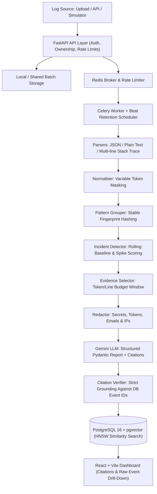

# IncidentLens Architecture

## System Overview

IncidentLens is an AI-powered incident log explainer that transforms noisy raw log batches into concise, evidence-linked root-cause reports verified against stored database events.

## Component Architecture

1. **API Layer (`backend/app/api/v1/endpoints/`)**:
   - `auth.py`: Email/password authentication with Argon2id hashing and `HttpOnly`, `SameSite=Lax` JWT session cookies (`Secure=True` in production).
   - `projects.py` & `api_keys.py`: Project scoping, strict per-user ownership isolation, and SHA-256-hashed ingestion API keys (`il_live_*`).
   - `ingest.py` & `logs.py`: Upload validation (`.log`, `.txt`, `.json`, `.jsonl`, `.ndjson`, `.csv`, max size limit, null-byte binary rejection), API-key log ingestion, idempotent batch processing, simulated scenario seeding, paginated event explorer, and event retention cleanup (`POST /projects/{id}/events/retention-cleanup`).
   - `patterns.py` & `incidents.py`: Fingerprinted error patterns, hourly counts, incident timelines, AI report trigger/regeneration, similar-incident retrieval (`pgvector`), and deployment marker management.
   - Security middleware (`backend/app/main.py` & `backend/app/core/errors.py`): Request ID correlation, explicit CORS allowlists, OWASP security response headers (`X-Content-Type-Options`, `X-Frame-Options`, `Referrer-Policy`, `Permissions-Policy`, HSTS in production), and exception handlers that mask internal stack traces when `DEBUG=false`.

2. **Core Pipeline (`backend/app/pipeline/`)**:
   - `parsers/` (`pipeline.py`, `json_parser.py`, `standard_parser.py`, `generic_parser.py`, `base.py`): Multi-format parsing with multi-line stack-trace coalescing and attribute extraction.
   - `normaliser/normaliser.py`: Deterministic masking of UUIDs, IPs, hex tokens, timestamps, and numbers to extract stable templates.
   - `grouping/pattern_grouper.py`: Stable template fingerprinting into `ErrorPattern` records (`backend/app/models/error_pattern.py`).
   - `detection/detector.py`: Rolling baseline rate calculation, z-score / burst spike detection, deployment proximity correlation, and ranked origin-pattern scoring.
   - `evidence/selector.py`: Selects minimal, high-signal evidence lines around incident windows within strict token/line budgets (yielding ~98.4% raw-to-LLM reduction).
   - `redaction/redactor.py`: Strips credentials, API tokens, bearer headers, emails, and PII before sending evidence snippets to external LLMs, while preserving real stored events in PostgreSQL.

3. **AI & Grounding Layer (`backend/app/ai/`)**:
   - `client.py`, `prompts.py`, `schemas.py`: Provider abstraction for Google Gemini (`google-genai`) structured Pydantic generation and offline deterministic mock clients for testing/evaluation.
   - `explainer.py`: End-to-end orchestration combining evidence selection, redaction, prompt construction, generation, verification, and vector embedding storage.
   - `verifier.py`: Parses inline `[Lx]` citations, validates every cited event ID against database records belonging to the incident's project, tracks verification status (`verified` vs. `partial` / `unverified`), and filters/flags ungrounded claims.
   - `embeddings.py`: Generates incident vector embeddings persisted with `pgvector` HNSW indexes for historical similar-incident lookup.

4. **Worker & Scheduling Layer (`backend/app/workers/`)**:
   - `celery_app.py` & `tasks.py`: Asynchronous Celery execution for `process_log_batch`, `explain_incident_task`, and daily Celery Beat `cleanup_old_events_task` using `EVENT_RETENTION_DAYS`.

5. **Storage Layer (`backend/app/models/` & `backend/app/repositories/`)**:
   - PostgreSQL 16 with `pgvector`: Indexed relational tables (`projects`, `api_keys`, `log_batches`, `log_events`, `error_patterns`, `incidents`, `incident_reports`, `deployment_markers`) with composite indexes for `(project_id, timestamp)` and `(project_id, fingerprint)` plus batched bulk inserts.
   - Redis 7: Celery message broker/backend and ingestion rate limiting.

6. **Frontend Dashboard (`frontend/src/pages/`)**:
   - React + TypeScript + Vite + Tailwind CSS SPA (`AuthPage.tsx`, `ProjectsPage.tsx`, `ProjectOverviewPage.tsx`, `UploadLogsPage.tsx`, `IncidentsListPage.tsx`, `IncidentDetailPage.tsx`, `PatternsPage.tsx`, `EventsExplorerPage.tsx`, `ProjectSettingsPage.tsx`).
   - Uses TanStack Query polling for async batch/AI states, Recharts for error-rate visualizations, and plain JSX rendering (no `dangerouslySetInnerHTML`) with click-to-inspect `[Lx]` citation evidence and raw event lookup.
