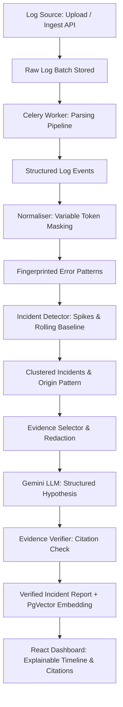

# IncidentLens Architecture

## System Overview

IncidentLens is an AI-powered incident log explainer with evidence-linked root-cause reports.

## Component Architecture

1. **API Layer (`backend/app/api/v1/`)**:
   - Authentication (Argon2id, JWT/cookies).
   - Project management & API key provisioning.
   - Upload & ingest endpoints.
   - Incident & report presentation.

2. **Core Pipeline (`backend/app/pipeline/`)**:
   - `parsers/`: Modular log format parsing (JSON, plain text, multi-line stack traces).
   - `normaliser/`: Regex-based variable token masking (UUIDs, timestamps, IPs, numbers).
   - `grouping/`: Stable hash fingerprinting into error patterns.
   - `detection/`: Rolling window error rate baseline and spike detection.
   - `evidence/`: Compact evidence window extraction with line budgets.
   - `redaction/`: Sensitive token (secrets, IPs, emails) masking before LLM transmission.

3. **AI Layer (`backend/app/ai/`)**:
   - Abstract interfaces for LLM and Embedding clients.
   - Gemini client with structured Pydantic output.
   - Verifier for checking claim citations against real event IDs.
   - Mock/fake implementations for offline CI and reproducible testing.

4. **Worker Layer (`backend/app/workers/`)**:
   - Celery worker tasks for batch ingestion, pattern clustering, and report generation.

5. **Storage Layer**:
   - PostgreSQL 16 with `pgvector` extension for relational data, JSONB attributes, and embedding similarity search.
   - Redis for Celery message broker and rate limiting.
